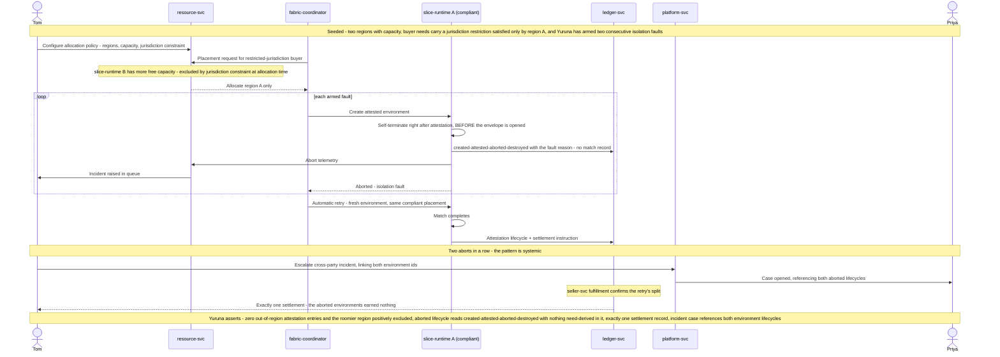

# s004.failover sequence — Sovereign Slice Allocation, Isolation Fault, and Attested Failover

> One sentence: jurisdiction rules pick the compliant region over the roomier one, an injected isolation fault destroys the environment safely and retries clean, and the systemic pattern escalates across party lines.

See [../design.md](../design.md#9-diagrams) - [s004.failover](../scenarios.md#s004failover-sovereign-slice-allocation-isolation-fault-and-attested-failover). slice-runtime B is folded into resource-svc (it is the roomier registered edge the policy excludes, and it exchanges no messages).

---

LICENSEURI https://yuruna.link/license

Copyright (c) 2026 by Alisson Sol et al.

[Design](../design.md) | [Design overview](README.md)
