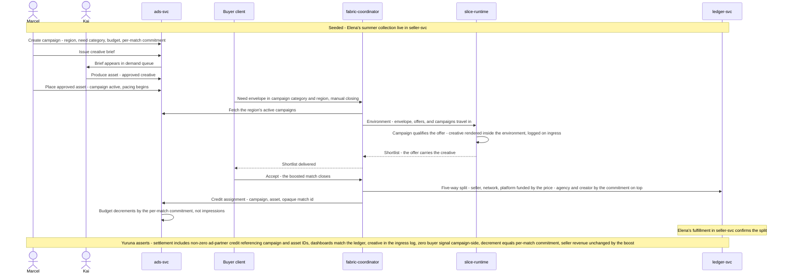

# s005.attribution sequence — Campaign-Boosted Match, Edge Creative Serving, and Attribution Credit

> One sentence: brief becomes creative, creative rides into the sealed environment with the qualified offer, and closing yields agency and creator credit computed in the fabric -- attribution without tracking.

See [../design.md](../design.md#9-diagrams) - [s005.attribution](../scenarios.md#s005attribution-campaign-boosted-match-edge-creative-serving-and-attribution-credit). Maya is folded into the buyer client; Elena's offer arrives via the coordinator's seller-svc fetch. insights-svc is left out: the s005 driver publishes no outlook (Marcel's demand view, an ads-svc read of the insights-svc outlook, runs in s009).

---

LICENSEURI https://yuruna.link/license

Copyright (c) 2026 by Alisson Sol et al.

[Design](../design.md) | [Design overview](README.md)
